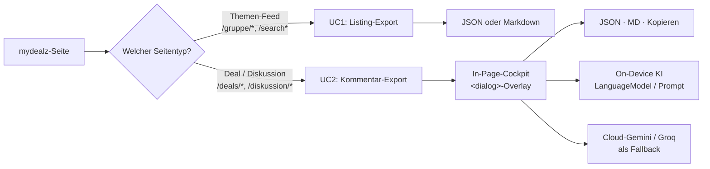

# MyDealz AI Exporter

Eine Chrome-Extension (Manifest V3, Vanilla JS) für [mydealz.de](https://www.mydealz.de): exportiert Deals und komplette Kommentar-Threads strukturiert als JSON oder Markdown — und analysiert sie optional mit KI, komplett on-device.

**Kein Backend, keine Cloud-Pflicht, kein Framework.** Alles läuft lokal in deinem eingeloggten Browser.

---

## Die zwei Use-Cases

Die Extension ist bewusst auf genau zwei Produkte eingefroren (siehe `docs/review_grok.md` §11):



### Use-Case 1 — Deal-Übersichten

Auf fokussierten Übersichtsseiten (`/gruppe/*`, `/search*` — inhomogene Feeds wie die Startseite bleiben bewusst ohne Widget) erscheint eine grüne Kapsel-Leiste unten rechts:

- **JSON** — alle sichtbaren Deals mit vollem Feldset: Titel, Beschreibung (Plaintext + HTML), Preise inkl. `displayPrice`, durchgestrichener UVP und berechneter Rabatt-%, Versandkosten (`shipping`, `shippingFree`), Temperatur, Kommentarzahl, Händler, Autor, Bearbeitungs-Zeitstempel (`updatedAt`), **Kategorie** (`mainGroup`/`groupsPath`), Ablaufstatus, Bild-URL, `shareLink` und alle Links der Beschreibung (`links[]`)
- **MD** — dieselben Daten als schablonenhafte, bilderfreie Markdown-Deal-Karten mit einheitlicher Feldreihenfolge
- **+2 Seiten** — lädt zusätzlich die zwei Folgeseiten (via `?page=N&ajax=true&layout=horizontal`, geparst aus den `data-vue3`-Payloads), dedupliziert gegen die sichtbare Seite. Bewusst knapp gedeckelt: max. 2 Extraseiten, 700 ms Pause — kein Ban-Risiko

### Use-Case 2 — Deal-/Diskussionsseiten

Auf `/deals/*`, `/gutscheine/*`, `/diskussion/*` sitzt ein Drei-Button-Widget unten rechts. Die Buttons stapeln sich als runde Pills über mydealz' nativem „Zum Seitenbeginn"-Button und nutzen dessen Button-Sprache (dunkle Kapsel, Averta-Typografie):

| Button | Funktion |
|---|---|
| 💬 **Antworten ausklappen** | Status-Anzeige + manueller Trigger. Klappt alle versteckten Antworten per nativem Klicken aus (`data-t="moreReplies"`), damit Strg+F den ganzen Thread durchsucht. Läuft **ausschließlich auf Klick** |
| 💾 **JSON** | Direkt-Download des kompletten Threads inkl. `_meta`, Permalinks und Linkliste — ohne Umweg über das Dashboard |
| 🧠 **Export & Analyse** | Holt **alle** Kommentare über GraphQL — inklusive aller Replies hinter den „Mehr Antworten anzeigen"-Buttons — und öffnet das Cockpit. Seitenunabhängig: egal ob du auf Seite 1 oder 7 stehst, der Export holt den kompletten Thread |

**Der Kommentar-Ping beim Seitenladen:** Der Export-Button fragt beim Laden einen einzigen Mini-GraphQL-Ping ab. Er liest `thread.commentCount` — die **echte Gesamtzahl inklusive Replies** — und ergänzt die Top-Level-Pagination nur für die Seitenzahl. Angezeigt wird zum Beispiel „110 Komm. · 2 Seiten"; die reine Top-Level-Zahl wäre deutlich kleiner.

**Ausklappen nur auf Klick:** `expandAllReplies()` hängt ausschließlich am Klick-Handler von `#mde-expand-btn`. Es gibt **keinen** Auto-Observer, keinen Timer und keinen automatischen Klick auf „Mehr Antworten". Der Seiten-Beobachter in `content/content.js` reagiert nur auf URL-Wechsel (Re-Injektion des Widgets), nicht auf Kommentare. Nach dem Nachladen weiterer Seiten wird erneut geklickt; der Button zählt die noch versteckten Antworten und terminiert sauber.

---

## Das Dashboard

Das v17.6-Cockpit ist radikal gestrafft: **eine Spalte, eine Aufgabe.** Kein Kommentar-Browser, keine Tabs, keine Sortierung, keine Suche und keine zusätzlichen Link-/Autor-Listen — die Kommentare stehen bereits direkt hinter dem Modal auf mydealz. Das Dashboard beantwortet nur noch die Fragen, die der Thread selbst nicht beantwortet.

Das Overlay folgt dem **DIN-BriefNEO-Muster**: kein neuer Tab, sondern ein `<dialog>` über der Deal-Seite (Inhalt im `iframe`, Lesebreite max. 820 px). **Esc**, ein **Klick auf den Backdrop** und der **✕-Button** schließen es; während der Öffnung ist der Seiten-Scroll gesperrt.

### a) Header & Deal-Metadaten

Die Kopfkarte bündelt den Kontext des Threads:

- **Titel** als Überschrift
- **Preis** als Chip; die **UVP** bleibt im mydealz-Preisblock daneben stehen und wird nicht als zweite Kachel dupliziert
- **Händler** und **Temperatur** als kompakte Chips
- **🔗 Deal öffnen** führt zurück zum Original
- **✕** schließt das Overlay (nur im eingebetteten Modus sichtbar)

### b) 📊 Deal-Scan (`#stats-section`)

Sieben Kennzahlen beantworten in einem Blick, wie groß und wie diskutiert der Thread ist:

| Kennzahl | Aussage |
|---|---|
| **Top-Level** | Anzahl der Hauptkommentare |
| **Replies** | sichtbare Antworten |
| **Max-Level** | tiefste erreichte Verschachtelungsebene |
| **📌 Autor\*in** | alle Beiträge des Dealerstellers, inklusive Replies |
| **👍 Likes** | Kommentare mit „Gefällt mir" |
| **💡 Helpful** | Kommentare mit „Hilfreich" |
| **😄 Funny** | Kommentare mit „Lustig" |

Die Kacheln sind reine Anzeige — kein Klickfilter, kein verstecktes Interaktionsmodell. Fehlende Replies (API-Deckel) erscheinen als transparente Warnzeile unter dem Raster.

### c) 🤖 KI-Analyse & Q&A

Sechs Schnell-Prompts als 3×2-Raster — **Zusammenfassung**, **Stimmung**, **Offene Fragen**, **Beste Kommentare**, **Probleme**, **Lohnt sich?** — plus ein Freitextfeld für eigene Fragen an den **gesamten Thread**. Die Antwort erscheint im Ausgabefeld und lässt sich mit dem **📋-Button** direkt kopieren.

Fallback-Kette:

```text
Chrome On-Device AI (LanguageModel / Assistant)  →  Gemini API-Key aus dem Popup  →  klare Fehlermeldung
```

Bei Threads mit mehr als 250 relevanten Kommentaren läuft automatisch **Map-Reduce**: Batches à 40 werden einzeln zusammengefasst, die Zusammenfassungen bilden den Kontext für die finale Analyse — statt 20k Zeichen Rohmaterial in ein Modell zu stopfen.

### d) 💾 2×2-Export-Matrix

Vier gleichrangige Zellen, klar getrennt nach Format und Ziel:

| Zelle | Aktion | Inhalt |
|---|---|---|
| **💾 Download .json** | Datei speichern | vollständiger Thread inkl. `_meta`, Permalinks und `stats` |
| **📋 .json kopieren** | Clipboard | identischer JSON-Payload |
| **💾 Download .md** | Datei speichern | Markdown mit Deal-Scan, Autor\*in-Updates und 🔗-Linkliste |
| **📋 .md kopieren** | Clipboard | identisches Markdown |

Das Cockpit exportiert den **bereits geladenen** Payload — kein zweiter GraphQL-Lauf, keine zusätzlichen Requests.

---

## Daten-Export: Markdown vs. Token-sparendes Columnar-JSON

Beide Formate beschreiben denselben Thread — sie haben nur unterschiedliche Leser.

### Warum nicht einfach „JSON mit Objekten"?

Der naive Weg wäre ein Objektbaum: jedes Kommentarobjekt trägt seine Schlüssel
(`id`, `parentId`, `level`, `author`, `isAuthor`, `date`, `score`, `text`,
`authorRefs`) erneut, dazu Klammern, Anführungszeichen und Einrückung. Bei
hunderten Kommentaren wiederholt sich diese Syntax hunderte Male und frisst
**über 60 % des LLM-Kontextfensters** für Boilerplate statt für Inhalt.
Genau dieser Befund steht als Kommentar am Spaltenvertrag in
`content/content.js` (`LLM-Vertrag: Columnar-Tuple-Matrix`).

### Das Format: Schema einmal, Daten als Tupel

Die Columnar-Tuple-Matrix (inspiriert vom **DIN-BriefNEO**-Muster und
`[anchor:deep-modules]`) dreht das um: Der Vertrag steht **genau einmal** oben,
danach folgen nur noch Werte.

1. **`_llm.columns`** — die Spaltenreihenfolge, exakt einmal deklariert:
   `[id, parentId, level, author, isAuthor, date, score, text, authorRefs]`.
2. **`_llm`-Guide** — selbsterklärender Vertragskopf mit semantischen Anchors
   (`[anchor:ssot-principle]`, `[anchor:separation-of-concerns]`,
   `[anchor:deep-modules]`), Ziel, Formatname und einer Kurzbeschreibung je Spalte
   (`column_guide`): `parentId: null` = Top-Level, `level` 0–4, `isAuthor: true`
   = verbindliche Statusmeldung des Dealerstellers, `score` = gewichteter
   Community-Score (helpful×3 + replies×3 + like×2 + funny), `authorRefs` =
   weitere Kommentar-IDs desselben Nutzers.
3. **`comments`** — die Matrix selbst: eine Zeile pro Kommentar, Pre-order
   (Eltern vor Kindern), ohne einen einzigen wiederholten Schlüssel:

```json
{
  "_llm": {
    "format": "columnar-matrix [anchor:deep-modules]",
    "columns": ["id", "parentId", "level", "author", "isAuthor", "date", "score", "text", "authorRefs"],
    "column_guide": {
      "id": "Eindeutige Kommentar-ID",
      "parentId": "Eltern-ID (null bei Top-Level)",
      "score": "Gewichteter Community-Score (helpful*3 + replies*3 + like*2 + funny)"
    }
  },
  "comments": [
    [57123456, null,           0, "dealhunter", true,  "2026-11-24T09:12", 18, "Preis ist wieder da.", [57123499]],
    [57123499, 57123456,       1, "schnaeppchen", false, "2026-11-24T09:20",  6, "Danke, direkt bestellt.", []],
    [57123510, 57123456,       1, "sparfuchs",  false, "2026-11-24T09:31",  2, "Versandkosten?", []]
  ]
}
```

Der Parser braucht damit **eine** Zeile Schema statt eines Keys pro Feld und
Kommentar; LLMs lesen die Matrix zeilenweise, ohne Objektgrenzen zu suchen.

### Klare Rollenverteilung

| Leser | Format | Warum |
|---|---|---|
| **Mensch** | Markdown (`.md`) | Überschriften, Zitate, Emojis, Einrückung und 🔗-Links ergeben eine lesbare visuelle Hierarchie — dafür ist Kontextbreite kein Kostentreiber |
| **KI / LLM** | Columnar-JSON (`.json`) | Maximale Token-Effizienz: Schema einmal, Daten als Tupel, **rund 65 % Token-Ersparnis** gegenüber dem Objektbaum — mehr Thread passt ins Kontextfenster |

Die Columnar-Matrix wird beim direkten Thread-Export (💾 **JSON** im
In-Page-Widget) erzeugt. Die Cockpit-Zelle **💾 Download .json** liefert
denselben Thread als vollständigen Payload (`_llm`, `meta`, `stats`,
`comments`) — für Weiterverarbeitung, die Metadaten und Aggregrate braucht.

---

## Repository-Struktur

Drei Ordner, keine Build-Stufe. `manifest.json` und `service-worker.js` liegen bewusst in der Wurzel, weil MV3 sie dort erwartet:

```text
MydealzExporter/
├── manifest.json
├── service-worker.js
├── content/
│   ├── content.js
│   └── listing.js
├── ui/
│   ├── dashboard.html
│   ├── dashboard.js
│   ├── popup.html
│   └── icon16.png · icon48.png · icon128.png
└── tools/
    ├── health-check.mjs
    ├── repo-map-check.mjs
    ├── deal-schema-map.json
    └── EAST-WEST-MAP.md
```

| Pfad | Rolle |
|---|---|
| `content/content.js` | UC2: GraphQL-Kommentar-Walker, Reply-Ausklappen, In-Page-Widget und `<dialog>`-Rahmen; enthält den `shared-bootstrap` |
| `content/listing.js` | UC1: Listing-Widget, GraphQL-Chunking, AJAX-Folgeseiten, Markdown; derselbe `shared-bootstrap`-Block |
| `ui/dashboard.html` | Markup und CSS des einspaltigen Cockpits |
| `ui/dashboard.js` | Cockpit-Logik: Header, Deal-Scan, KI, Export — und `initPopupSettings()` für das Popup |
| `ui/popup.html` | Popup zum Setzen des Gemini-API-Keys (lädt `ui/dashboard.js`, kein eigenes `popup.js`) |
| `ui/icon16.png` · `icon48.png` · `icon128.png` | Icon-Satz für Manifest, Action und Cockpit-Header |
| `tools/health-check.mjs` | Health-Check: Code-/Manifest-Gates, Script-Auflösung, GraphQL-/DOM-Drift (`--offline` nur statisch) |
| `tools/repo-map-check.mjs` | Budget-Gate: AGENTS.md ≤ 70 und map.md ≤ 100 Zeilen, Module 15–40 KiB, `shared-bootstrap` byte-identisch |
| `tools/deal-schema-map.json` | Soll-Feldliste (16 Felder) für Drift-Checks |
| `tools/EAST-WEST-MAP.md` | Schema-Matrix DOM vs. GraphQL inklusive Feldzuordnung und Drift-Notizen |
| `service-worker.js` | Einziger Service Worker: nimmt den Export-Payload entgegen und legt ihn in `chrome.storage.session` ab |
| `manifest.json` | Permissions, Content-Script-Matches, Service Worker, Popup, Icons |
| `docs/` | Dokumentations-Verzeichnis (`data_insights.md`, `review_grok.md`, `methodik.md`, `AI-AGENTS-CLI.md`) |

Das Wurzelverzeichnis enthält strikt die Einstiege (`README.md`, `AGENTS.md`, `map.md`, `CLAUDE.md`, `GEMINI.md`, `manifest.json`, `service-worker.js`). Vertiefende Doku wohnt in `docs/`. Die vier Kern-Verzeichnisse lauten `content/`, `ui/`, `tools/` und `docs/`.

---

## Architektur

### Tiefe Module statt Dateizoo `[anchor:deep-modules]`

Jede Content-/UI-JS-Datei liegt zwischen **15 und 40 KiB** (≈300–800 Zeilen). Das ist keine Ästhetik, sondern eine Kostenrechnung: eine Datei unter 5 KiB erzeugt beim Lesen, Patchen und Testen jeweils einen eigenen Tool-Call samt Kontext-Hop, ohne selbst Verhalten zu tragen — ein *Shallow Module*.

Zero-Build heißt: Content-Scripts können keine ES-Module importieren. Statt einer Mini-Datei liegt der gemeinsame Bootstrap (Link-Extraktion + `fetchWithRetry`) deshalb **byte-identisch** als `// #region shared-bootstrap` in `content/content.js` und `content/listing.js`. `tools/repo-map-check.mjs` vergleicht die Region bei jedem Lauf und schlägt bei Drift fehl; dieselbe Prüfung erzwingt die 15–40-KiB-Grenze.

Das Popup hat kein eigenes `popup.js`: `ui/popup.html` lädt `ui/dashboard.js`, und der DOM-Zweig `initPopupSettings()` bedient die Key-Eingabe. Grund ist eine harte Plattformgrenze — **MV3 verbietet Inline-Scripts in `extension_pages`** (`script-src` darf nur `'self'`, `'none'`, `'wasm-unsafe-eval'` enthalten; CSP-Hashes sind ebenfalls nicht erlaubt). Ein Inline-Script würde also stillschweigend nie ausgeführt; das Einbetten in ein bestehendes tiefes UI-Modul löst dieselbe Aufgabe ohne Shallow File.

Vorbild ist John Ousterhout, *A Philosophy of Software Design*: ein tiefes Modul hat eine schmale Schnittstelle und viel Verhalten dahinter — nicht viele kleine Dateien mit je einer Funktion.

### Der GraphQL-Walker (UC2)

Der wertvolle Kern — Kommentare werden nicht aus dem DOM geschabt, sondern direkt von `/graphql` geholt:

```graphql
query($filter: CommentFilter!, $limit: Int, $page: Int) {
  comments(filter: $filter, limit: $limit, page: $page) {
    items { commentId preparedHtmlContent reactionCounts { type count } … }
    pagination { count last }
  }
}
```

- **Top-Level** paginiert (100/Seite), Sortierung aufsteigend
- **Replies** über den `mainCommentId` + `threadId` Composite-Key — mydealz-Absonderheit: ohne `threadId` liefert der Endpunkt still nichts (dokumentiert in `data_insights.md`)
- **30er-Alias-Batches** für fehlende Replies, mit Höflichkeitspausen
- `repliesPreview` wird ausgenutzt: die meisten Unterhaltungen stecken schon im Root-Objekt

### Robustheit

- **Retry/Backoff** nur bei transienten Fehlern (408/429/5xx, Netzwerk), 403/404 werfen sofort; `Retry-After`-Header schlagen das Eigen-Backoff
- **Rate-Limit-Disziplin** überall: 300–700 ms Pausen, gedeckelte Extraseiten, pausierte Reply-Batches
- **CSRF** aus Meta-Tag mit `xsrf_t`-Cookie-Fallback (inkl. Unquoting)
- Fehlermeldungen im Button-Label sind verständlich: „Rate-Limit (429)", „Kein XSRF-Token", „Netzwerk-Timeout" — keine stillen Fehler

### Datenquellen statt CSS-Geräte

Die Extension liest mydealz' strukturierte Datenlayer, nicht styling-abhängige Klassen:

| Quelle | Genutzt für |
|---|---|
| GraphQL `/graphql` | Kommentare, Replies, Thread-Felder (UC2 + UC1-Enrichment) |
| `data-vue3`-Payloads | Thread-IDs + outbound deal-Link/Händler-Domain auf Listings, AJAX-Folgeseiten |
| `data-t`-Attribute | Metadaten-Selektoren, Ausklapp-Buttons — mydealz' eigene stabile Hook-Schicht |
| Portale (`#threadDescriptionItemPortal`, …) | Beschreibung, Zusatzinfos |

---

## Datenschutz

- Alle Daten bleiben auf deinem Gerät: Export-Payload läuft über den Service Worker ins Cockpit, keine Server-Kommunikation außer zu mydealz selbst
- Cloud-Gemini ist **opt-in** und nur Fallback — der API-Key liegt in `chrome.storage.local`
- Die Extension sammelt nichts, trackt nichts, hat keine externen Hosts außer `generativelanguage.googleapis.com` (nur für den Fallback-Pfad)

---

## Nutzungshinweis (ToS)

Dies ist ein **inoffizielles, persönliches Community-Tool** — keine offizielle mydealz-Funktion. mydealz untersagt Crawling in seinen Nutzungsbedingungen; die Extension automatisiert Zugriff mit der eigenen Session (GraphQL-Pagination, AJAX-Folgeseiten, manuelles Ausklappen auf Klick). Bewusste Eingrenzung gegen die Massen-Export-Variante: max. 2 Extraseiten, Höflichkeitspausen, keine Cron-Loops, Export nur auf Nutzerklick.

Konsequenz: **nutzen auf eigenes Risiko** (persönliche Nutzung, sinnvolles Tempo). Dieses Repo gehört nicht zu mydealz/Pepper und erhebt keinen Anspruch auf Duldung.

## Bekannte Grenzen

- **Verborgene Replies:** Sehr tiefe Reply-Bäume kann die API deckeln (`_hiddenReplies`-Feld zeigt die Anzahl transparent im Cockpit)
- **Rate-Limit bei HTTP 200 + HTML:** mydealz liefert bei Drosselung gelegentlich HTML statt JSON — wird aktuell als kryptischer Fehler geworfen (bekanntes Ticket, siehe `data_insights.md`)
- **KI on-device:** `LanguageModel`/`Assistant` sind Chrome-Preview — Verfügbarkeit hängt von Version/Hardware ab, der Cloud-Fallback fängt es auf
- **Gutscheine/Diskussionen:** Preis-/Händler-Felder sind dort naturgemäß `null`
- **Preis-Felder sind Community-Eintragungen:** `price`/`discountPct` sind das, was der Poster eingetippt hat — auf Freebies- und Coupon-Threads fehlen sie vollständig (Feldabdeckung je Kategorie 55–80 %), gelegentlich weichen sie vom Titeltext ab. Der Titel bleibt die menschenlesbare Quelle der Wahrheit

---

## Projekt-Dokumentation

- `docs/data_insights.md` — GraphQL-Eigenheiten, Datenquellen-Erkenntnisse, alle übernommenen Techniken aus Community-Quellen
- `docs/review_grok.md` — Zielarchitektur, Use-Case-Grenzen, Review-Gegenprüfung
- `AGENTS.md` · `map.md` — Verhaltensvertrag und Task-to-File-Navigation für Agenten
- `docs/AI-AGENTS-CLI.md` — Entwickler-Workflow (Extension laden, DevTools-MCP, Systemprompt)
- `tools/health-check.mjs` — Health-Check über alle vier Säulen (`--offline` für die statischen Gates)
- `tools/repo-map-check.mjs` — Budget- und Modul-Gate (15–40 KiB, `shared-bootstrap`)

## Inspiration & Credits

Techniken und Ideen aus der mydealz-Community (alles detailliert in `data_insights.md` referenziert):

- **[Sammlung: Starten statt warten](https://www.mydealz.de/diskussion/sammlung-mydealz-auch-ohne-app-nutzen-2035404)** — die zentrale mydealz-Tooling-Sammlung; [Zusätzliche Info 103930](https://www.mydealz.de/diskussion/sammlung-mydealz-auch-ohne-app-nutzen-2035404#additionalInfo-103930) enthält den kategorisierten Tool-Index aller Skripte, Bookmarklets und Erweiterungen
- **[MD928835](https://greasyfork.org/de/users/1419623-md928835)** (a.k.a. „Anonymer Benutzer", Thread-Gründer der Sammlung) — Autor von Kommentarvolltextsuche, data-vue Inspector und Direktlink-Entzauberung; die produktivste Quelle für GraphQL- und data-vue-Erkenntnisse
- **[9jS2PL5T](https://greasyfork.org/de/users/1412069-9js2pl5t)** — Co-Autor der [Kommentarvolltextsuche](https://greasyfork.org/de/scripts/524875), aktiv gepflegte Umsetzung der Community-Bookmarklets
- **[PepperDealsScraper](https://github.com/amintikk/PepperDealsScraper)** (Python, 10 Pepper-Portale) — AJAX-Pagination-Muster, Retry/Backoff, Filter-URL-Params
- **[Comment Section Exporter](https://greasyfork.org/en/scripts/557220)** (piknockyou) — GQL-Feldbestätigungen (`wasEdited`/`isPinned`/`createdAtTs`), präzise Meta-Selektoren
- **[Nergico: Kommentarsuche](https://github.com/Nergico/MyDealz-Kommentarsuche-mit-Lesezeichen)** — Volltextsuche-Feature-Idee, Permalink-Formate, Refresh-Detection
- **[data-vue Inspector](https://greasyfork.org/de/scripts/592027)** (MD928835) — Feld-Discovery-Werkzeug für Schema-Erweiterungen
- **Eigener Vorgänger:** Deep-State AI Exporter v11–12.3 — Inline-Links, OP-Marker, IndexedDB-Cache-Muster, `createdAtTs`
